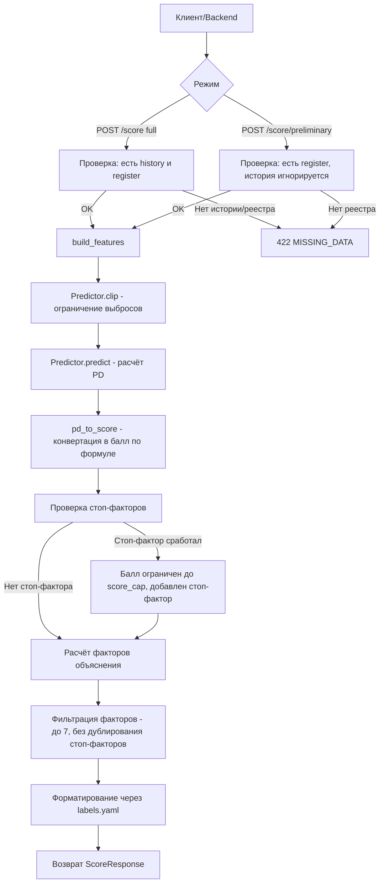

# ML-контракт (v3)

## Обзор

ML-сервис предоставляет два эндпоинта для скоринга кредитных заявок малого и микробизнеса:
- `POST /score` - полный скоринг (требует историю бюро и реестр)
- `POST /score/preliminary` - предварительный скоринг (только реестр, без истории бюро)

Сервис принимает сущность заявки целиком (`ApplicationIn`) и рассчитывает признаки самостоятельно.

## Входные данные

Запрос принимает объект заявки со следующей структурой (ключевые поля):

```json
{
  "id": 10,
  "userId": 2,
  "organizationId": 2,
  "sum": 100000000,
  "status": "SUBMITTED",
  "createdAt": "2026-10-24T10:22:22.472Z",
  "creditTime": { "units": "YEAR", "value": 1 },
  "applicationScore": {
    "id": 9,
    "applicationId": 10,
    "history": {
      "creditHistory": [
        { "provisionDate": "2022-05-10", "sum": 50000, "status": "PAID", "paymentDeadline": "2023-05-10" }
      ],
      "bankrupt": false,
      "casesDelayedPayment": 0
    },
    "registerInfo": {
      "isActive": true,
      "registrationDate": "2021-01-15",
      "authCapital": 20000,
      "employeesCount": 24,
      "annualIncome": 400000,
      "annualExpenses": 200000,
      "lastYearBalances": [100000, 100040, 100023, 140022, 200342, 123333],
      "ogrn": "1234567890124",
      "okved": "58.19",
      "head": "Иванов Иван Иванович",
      "kpp": "500101001",
      "bankClientSince": "2023-01-15",
      "address": "г. Москва",
      "account": "4015****23"
    }
  },
  "loanIssuanceDate": "2026-10-24T10:22:22.472Z"
}
```

**Правила парсинга:**
- Поля `history` и `registerInfo` могут быть вложены в `applicationScore.history` / `applicationScore.registerInfo`, либо переданы напрямую в корне запроса
- Блок `applicationScore.info` также поддерживается (flattening)
- Если `history` или `registerInfo` это объект с `error` или пустой объект `{}`, они считаются отсутствующими (`null`)
- Неизвестные поля игнорируются (`extra="ignore"`)
- `creditTime.units` может быть строкой (`"YEAR"`, `"MONTH"`, `"DAY"`) или числом enum
- Статусы кредитов: `PAID` считается погашенным, остальные - активными
- Для ИП ОГРН из 15 цифр, у ИП нет `kpp`; для ООО ОГРН из 13 цифр

## Ответ сервиса (v3)

```json
{
  "pd": 0.071,
  "score": 72,
  "risk_class": "C",
  "rate_premium_pp": 1.0,
  "model_version": "logreg-0.1",
  "updated_at": "2026-10-25T12:34:56.789012Z",
  "mode": "full",
  "factors": [
    {
      "feature": "avg_revenue_monthly",
      "title": "Среднемесячная выручка",
      "description": "Выручка около 33333 ₽ в месяц (типичное значение 50000 ₽).",
      "points": -5,
      "advice": "Запросите сумму поменьше или подайте заявку, когда выручка вырастет."
    }
  ]
}
```

**Поля ответа:**
- `pd` (float, 0-1) - вероятность дефолта
- `score` (int, 0-100) - скоринговый балл. **Чем выше балл, тем лучше**. Расчитывается из PD по формуле дизайна кабинета
- `risk_class` (string) - класс риска: `A` (>=80), `B` (>=70), `C` (>=60), `D` (>=45), `E` (<45)
- `rate_premium_pp` (float) - надбавка к ставке продукта в п.п. (ML отдаёт надбавку, итоговую ставку считает backend)
- `model_version` (string) - версия модели
- `updated_at` (datetime) - время расчёта
- `mode` (string) - режим расчёта: `full` или `preliminary`
- `factors` (array) - факторы, влияющие на оценку (от 1 до 7 штук)

**Формат фактора:**
```json
{
  "feature": "business_age_months",
  "title": "Возраст бизнеса",
  "description": "Бизнес работает 24 мес. (типичное значение 36).",
  "points": 3,
  "advice": null
}
```
- `feature` - техническое название признака
- `title` - человекочитаемый заголовок
- `description` - описание с конкретными цифрами из заявки
- `points` - вклад в балл (положительный повышает балл, отрицательный понижает). Для стоп-факторов тоже отрицательный
- `advice` - совет клиенту. **Обязателен для факторов с `points < 0`**, отсутствует или `null` для положительных

**Изменения относительно v2:**
- Убраны поля `label` и `impact` из факторов
- Добавлены `score`, `risk_class`, `rate_premium_pp`, `updated_at`, `mode`
- Балл вместо PD в качестве основного индикатора для пользователя
- Факторы в человекочитаемом формате с `title`, `description`, `advice`
- Показываются все релевантные факторы (до 7), а не топ-5

## Обработка ошибок

- **422 Unprocessable Entity** - нехватка обязательных данных. Ответ: `{"detail": {"code": "MISSING_DATA", "missing": ["history", "registerInfo.registrationDate"]}}`. В полном режиме требуются история и реестр; в предварительном достаточно реестра
- **500 Internal Server Error** - непредвиденная ошибка. Детали не возвращаются клиенту (логируются только на сервере)

## Поток данных



## Допущения и ограничения

- **Синтетические данные:** модель обучена на синтетически сгенерированных данных. Метрики демонстрационные
- **Просрочки:** используется количество случаев просрочки (`casesDelayedPayment`), т.к. в данных нет точного числа дней просрочки
- **Стабильность оборота:** `lastYearBalances` (остатки по счёту) используется для расчёта коэффициента вариации как замена нестабильности выручки
- **Форма собственности:** определяется по длине ОГРН (15 цифр - ИП, 13 цифр - ООО). У ИП отсутствует КПП
- **Единицы срока кредита:** поддерживаются как строковые (`YEAR`/`MONTH`/`DAY`), так и числовые enum значения
- **Долговая нагрузка:** рассчитывается по активным кредитам из кредитной истории. Платеж по кредиту оценивается как `sum / (месяцы между provisionDate и paymentDeadline)`, минимум 1 месяц
- **Залог:** поля `product.isSecured`, `collateral` поддерживаются схемой, но могут не влиять на текущую модель
- **Внешние проверки:** данные по ФНС, арбитражу, санкциям пока не передаются и не используются
- **Выбросы:** значения ограничиваются диапазонами из обучающей выборки, факт ограничения отражается в описании фактора
- **Надбавка к ставке:** границы предположительные, могут быть скорректированы
